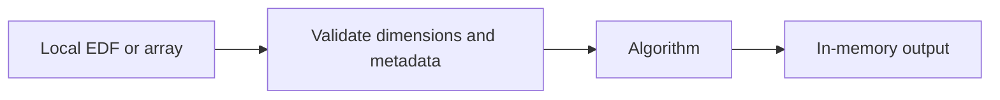

# eeg-seizure-ml-baselines

Patient-grouped classical machine learning pipelines.

Python 3.10+ · MIT code license · Research and engineering portfolio

## Installation

Clone this repository and create a virtual environment:

```bash
git clone https://github.com/hassenouni/eeg-seizure-ml-baselines.git
cd eeg-seizure-ml-baselines
python -m venv .venv
```

Activate the environment (`.venv\Scripts\Activate.ps1` on Windows or
`source .venv/bin/activate` on Linux/macOS), then run:

```bash
python -m pip install "eeg-dataset-explorer @ git+https://github.com/hassenouni/eeg-dataset-explorer.git@v0.1.0"
python -m pip install -e ".[dev,plots]"
python -m pytest
python -m ruff check src tests examples
python examples/demo.py
```

Install the versioned shared EDF package first, as shown above. 
For local portfolio development, editable sibling installations are supported.
The shared packages are distributed through GitHub tags, not PyPI.
A GitHub Actions template in `docs/ci/tests.yml` runs lint, format checks and tests
on Python 3.11. It is not active yet. To activate it after granting the GitHub
`workflow` permission, move it to `.github/workflows/tests.yml` and push.

## Architecture



See [algorithm details](docs/ALGORITHMS.md) for input contracts, methods and limitations.
The demo uses explicitly synthetic signals by default and can load a local real
sample with `--sample data/samples/chb-mit.npz`. No fitted models or benchmark scores
are distributed. Tests verify software behavior, not clinical effectiveness.

## Original EEG examples

`data/samples/` is reserved for local CHB-MIT and Siena excerpts. Generate them
from your own downloaded EDFs with the standalone extraction commands below.
No patient data is included in this public repository. The extractor preserves
source EDFs and writes calibrated amplitudes, channel metadata and provenance.
NPZ files and their local manifests are ignored by Git. The MIT license covers
code; source datasets retain their own terms and citation requirements.

## Scope

No full training, experimental scores, or claims of seizure detection performance.
Channel montages and patient identities must be reviewed before combining datasets.
Examples are reproducible software demonstrations, not clinical recommendations.

## Standalone local sample extraction

With the shared EDF package installed, choose EEG channel names from the header:

```bash
python -m eeg_dataset_explorer YOUR_RECORDING.edf
python -m eeg_dataset_explorer YOUR_RECORDING.edf --seconds 8 --channels CHANNEL_A CHANNEL_B --export-npz data/samples/local.npz
python examples/demo.py --sample data/samples/local.npz
```

The extractor writes an adjacent JSON manifest with source and excerpt SHA-256,
channel names, sample boundaries, calibration and units. No seizure labels are
inferred. Local manifests are ignored by Git alongside the NPZ files.

## Python API

The following is an API recipe; variables represent caller-supplied arrays.
For a fully executable example, use `examples/demo.py`.

```python
from eeg_ml.algorithms import patient_split, make_pipeline
# X: features; y: binary labels; groups: true patient identities
train, test = patient_split(X, y, groups)
pipeline = make_pipeline("svm")
# Optional explicit training, never executed by importing the module:
# pipeline.fit(X[train], y[train])
```
